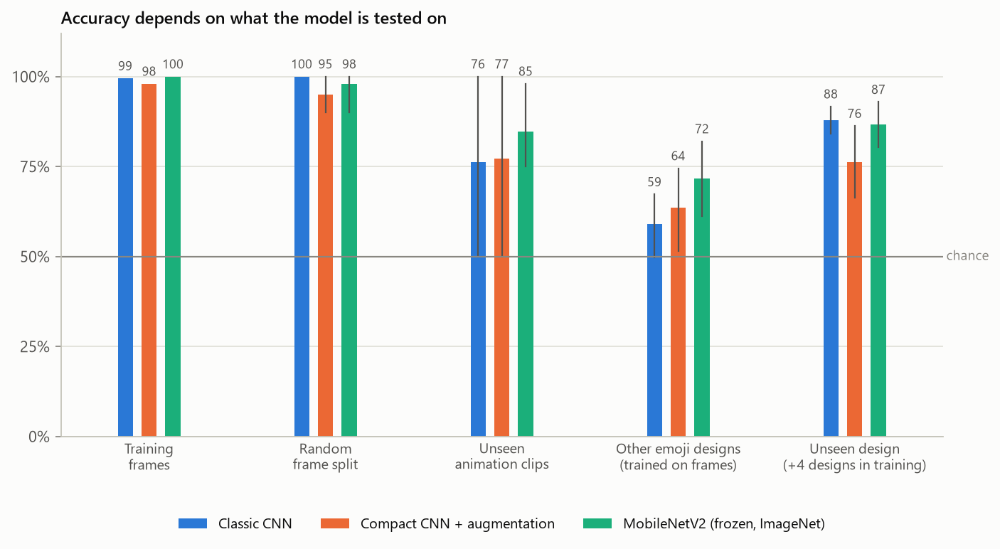
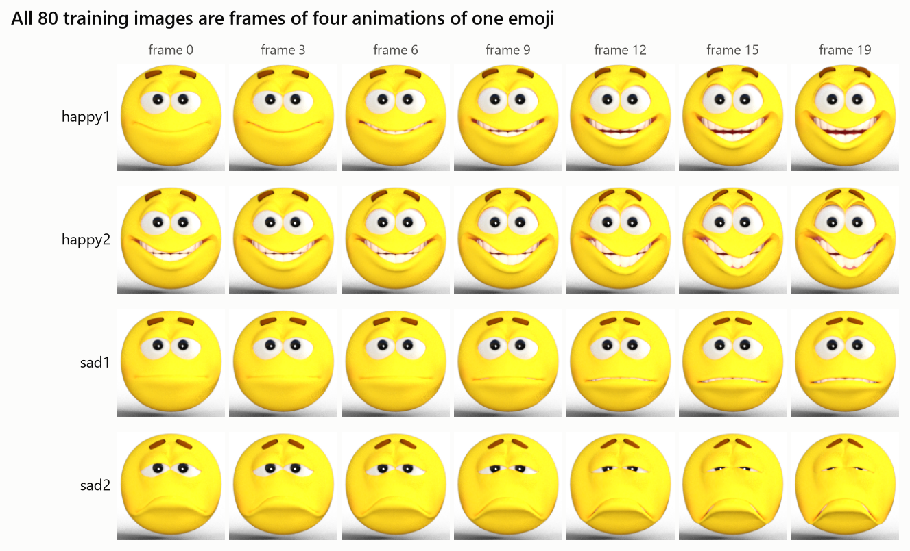
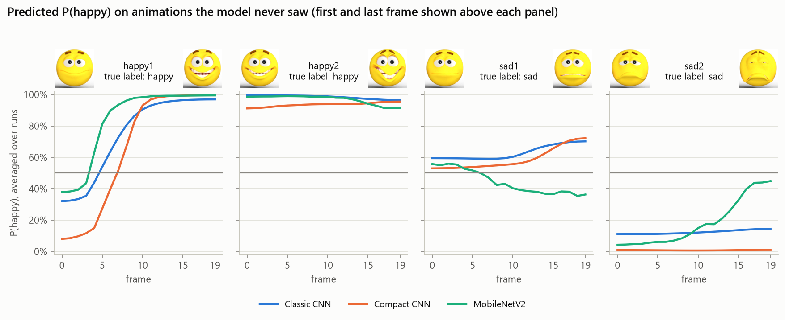
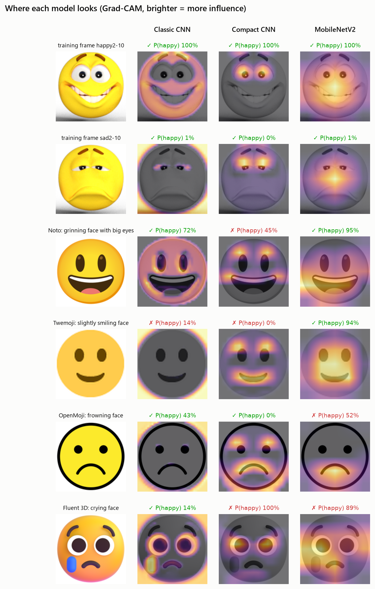
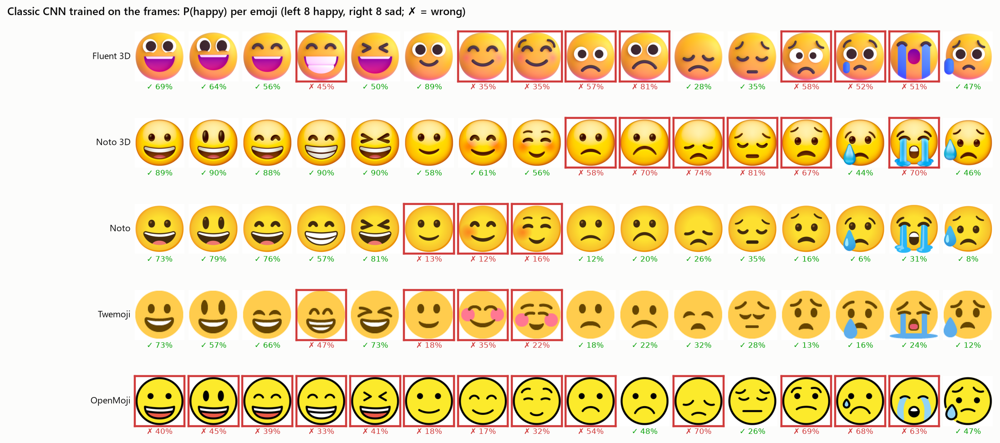
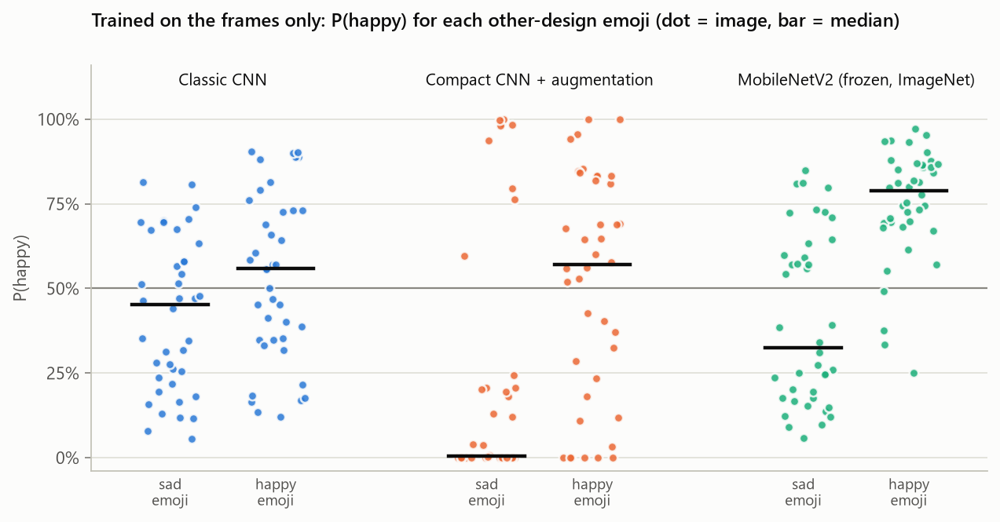
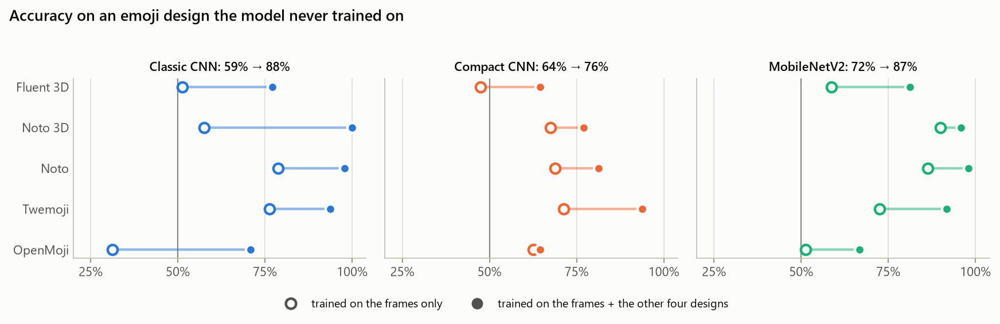
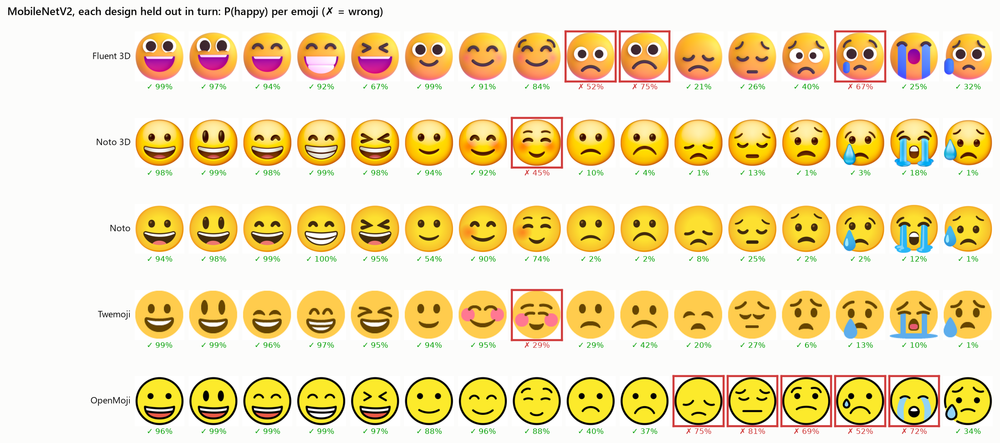
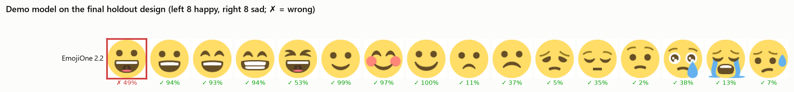

# Happy or Sad? What a CNN Really Learns from One Emoji

A convolutional neural network can tell happy emoji from sad ones with 99.9% accuracy after a few seconds of training on the popular 80-image *happy-or-sad* dataset. This project asks what that number actually measures. It retests three architectures on animation clips they never saw, on the same 16 emoji drawn by five other emoji designs, and on a sixth design held back until the very end. It then uses Grad-CAM to see which part of the face each model looks at.



## Results

All models were trained on a laptop CPU. Numbers are averaged over 5 random seeds (3 for the last column). With two classes, guessing scores 50%.

| Model | Parameters | Training frames | Random frame split | Unseen animation clips | Other emoji designs, trained on frames (95% CI) | Unseen design, +4 designs in training (95% CI) |
|---|---|---|---|---|---|---|
| Classic CNN | 9.5M | 99.5% | 100.0% | 76.1% | 59.0% (50%–67%) | **87.9%** (84%–92%) |
| Compact CNN + augmentation | 98K | 98.0% | 95.0% | 77.3% | 63.5% (52%–75%) | 76.2% (66%–86%) |
| MobileNetV2 (frozen, ImageNet) | 2.3M (1,281 trained) | 100.0% | 98.0% | **84.8%** | **71.8%** (61%–82%) | 86.7% (80%–93%) |

- **The usual evaluation says the problem is solved.** Every model scores 95–100% on the training frames and on a random 25% of frames held out as a test set.
- **Every other test says it isn't.** On animations they never saw, the models drop to 76–85%. On the same 16 emoji drawn by other designers, the two CNNs trained from scratch are barely better than a coin flip (59% and 64%).
- **Pretrained features help most when the data is narrow.** Trained on the frames alone, MobileNetV2 is the only model that clearly beats chance on the other designs (72%), and Grad-CAM shows it is the only one that looks at the mouth.
- **More varied data helped more than any architecture.** Adding 64 images from four other designs lifted the classic CNN from 59% to 88% on a fifth design it never saw. No change of architecture came close.
- **The final check passed.** The demo model (MobileNetV2 trained on all 160 labeled images) scored 15 out of 16 on EmojiOne, a design that no experiment had used.

## The main finding: 80 images, but only one emoji

The dataset looks like 40 happy and 40 sad faces. Reading the file names and looking at the images shows something else: every image is a frame of one of **four short animations of the same 3D emoji**. Two animations morph into a grin and two into a frown, with 20 frames each.



This has two consequences:

- **Neighboring frames are near-duplicates.** Consecutive frames differ by 0.8 out of 255 per pixel on average. A random train/test split puts the neighbors of every test frame in the training set, so a 100% test score only shows the model recognizes frames it has nearly seen.
- **The label is only clear at the end of each animation.** The first frame of `happy1` is three times closer in pixel space to the first frame of `sad1` than to the last frame of its own animation. Both start from an almost neutral face.

To measure generalization honestly I used three stricter protocols:

1. **Unseen animation clips.** Train on one happy and one sad animation and test on the other two. There are four ways to pair them, so four folds.
2. **Other emoji designs.** Train on all 80 frames and test on 16 standard emoji (8 happy, 8 sad) as drawn by Microsoft Fluent 3D, Google Noto 3D, Google Noto, Twemoji and OpenMoji.
3. **Unseen design.** Train on the frames plus four of those designs and test on the fifth, five folds in turn.

A sixth design, EmojiOne 2.2, was downloaded but kept out of every experiment. It was used once, to test the model I ship.

## What I built

- **A data pipeline** that downloads the dataset and checks its SHA-256 checksum, parses clip and frame numbers from the file names, and builds clip-level and design-level splits. It also downloads 96 emoji images in six designs from five open-source emoji projects, each pinned to a fixed commit or release so the test sets never change.
- **Correct handling of transparency.** The training PNGs have transparent backgrounds stored as black pixels. Keras' `load_img` and `image_dataset_from_directory` silently drop the alpha channel, so the standard pipeline trains on faces sitting on a black background (about 28% of each image). Here, every image is composited onto white, and each emoji is cropped and padded so the face fills the frame the same way it does in the training images.
- **Three models**: the classic three-block CNN usually used with this dataset, a compact CNN with global average pooling and augmentation, and a frozen ImageNet MobileNetV2 with a new head.
- **An experiment runner** that trains every model under every protocol and seed (135 runs, 79 minutes of CPU time). It writes one row per run and one row per test prediction, and resumes from where it stopped if interrupted.
- **An evaluation suite**: accuracy per protocol, fold and design; 95% confidence intervals from resampling whole emoji; probability curves along each animation; and Grad-CAM heatmaps.
- **A command-line classifier** for any image, with an optional Grad-CAM output, plus unit tests and GitHub Actions CI.

## Data

| Set | Images | Source | License | Used for |
|---|---|---|---|---|
| Animation frames | 80 (4 clips × 20) | [happy-or-sad](https://storage.googleapis.com/learning-datasets/happy-or-sad.zip) by Laurence Moroney | see source | Training in every protocol |
| Fluent 3D | 16 | [microsoft/fluentui-emoji](https://github.com/microsoft/fluentui-emoji) | MIT | Testing; training in the unseen-design folds |
| Noto 3D, Noto | 16 + 16 | [googlefonts/noto-emoji](https://github.com/googlefonts/noto-emoji) | Apache 2.0 | Same |
| Twemoji | 16 | [jdecked/twemoji](https://github.com/jdecked/twemoji) | CC BY 4.0 | Same |
| OpenMoji | 16 | [hfg-gmuend/openmoji](https://github.com/hfg-gmuend/openmoji) | CC BY-SA 4.0 | Same |
| EmojiOne 2.2 | 16 | [joypixels/emojione v2.2.7](https://github.com/joypixels/emojione/tree/v2.2.7) | CC BY 4.0 | Final holdout only |

The 16 emoji are, happy: grinning face, grinning face with big eyes, grinning face with smiling eyes, beaming face with smiling eyes, grinning squinting face, slightly smiling face, smiling face with smiling eyes, smiling face. Sad: slightly frowning face, frowning face, disappointed face, pensive face, worried face, crying face, loudly crying face, sad but relieved face. Faces with ambiguous expressions (tears of joy, upside-down face) were left out on purpose.

Images are not stored in the repository; `python -m src.data` downloads them (about 15 MB).

## Models and training

| Model | Architecture | Parameters | Training recipe |
|---|---|---|---|
| Classic CNN | 3 × (conv + max-pool), flatten, dense 512 | 9,494,561 | RMSprop, stop when training accuracy reaches 99.9% (at most 15 epochs) |
| Compact CNN | 4 × (conv + max-pool), global average pooling, dropout | 97,569 | Adam, 100 epochs, augmentation |
| MobileNetV2 | Frozen ImageNet backbone at 160×160, new sigmoid head | 2,259,265 (1,281 trainable) | Adam, 20 epochs, augmentation |

- **Augmentation**: horizontal flips, rotation up to ±18°, zoom, shifts, and contrast and brightness changes. Pixels exposed by a rotation or shift are filled with white, to match the background.
- **No tuning on test data.** Recipes were fixed by watching the training loss on the frames before any test result existed. There is no validation set, because with four clips any validation frames would leak in the same way the random split does.
- **Scaling happens inside each model**, so a saved model works on a raw image array with no separate preprocessing step.
- A full training run on all 80 frames takes 20–50 seconds on a 4-core laptop CPU.

## A closer look

**What happens along an animation the model never saw?** Each curve is P(happy) for one held-out clip, averaged over folds and seeds:



All three models call the nearly neutral opening frames of `happy1` sad, then switch as the grin appears. That is reasonable, because those frames are barely smiling. The bigger failure is `sad1`, whose face ends in a tense grimace with the teeth showing. The two CNNs trained from scratch rate the whole clip as slightly happy and grow more confident as the teeth appear. MobileNetV2 is the only model that moves toward "sad" as the expression develops. In the fold that trains on `happy1` and `sad2` and tests on `happy2` and `sad1`, both from-scratch CNNs score exactly 50% for every seed.

**Where does each model look?** Grad-CAM highlights the regions that pushed each model toward its answer:



The classic CNN's heatmaps light up the outline of the face and the background around it, which is a property of this one emoji and not of happiness. The compact CNN concentrates on the eyes and eyebrows. MobileNetV2 is the only model that consistently looks at the mouth.

**What does the classic CNN do with other designs?** Trained on the frames only, it calls 14 of the 16 Noto 3D emoji happy. It gets OpenMoji backwards: it calls all 8 happy faces sad and 5 of the 8 sad faces happy, for 31% accuracy, well below chance. Its decisions follow outlines and shading rather than the expression.



Trained on the frames alone, the models also differ in how well they separate the two classes at all:



**What does more varied data buy?** Each design is held out in turn while the other four join the training set:



Every model improves on every design. The classic CNN gains the most, from 59% to 88%. The two hardest designs stay hard. Fluent 3D draws its frowning faces with big, wide-open eyes, like the happy training frames, and MobileNetV2 calls three of them happy. In OpenMoji's flat style with thick black outlines, five of the eight sad faces still come out "happy":



**The final holdout.** The shipped model is MobileNetV2 trained on all 160 labeled images. I chose MobileNetV2 before looking at the holdout: it tied the classic CNN on unseen designs (86.7% vs 87.9%, well within noise), was far more robust when trained on the frames alone, looks at the mouth, and is an 8× smaller file. On EmojiOne it gets 15 of 16 right. The only miss is the grinning face, at 49%.



All tables, including per-fold and per-design results, are in [reports/summary.md](reports/summary.md). Every run is in [reports/runs.csv](reports/runs.csv) and every test prediction is in [reports/predictions.csv](reports/predictions.csv).

## What I learned

1. **A near-perfect score on a tiny dataset can be pure memorization.** All three models reach 95–100% under the usual evaluation, yet the two trained from scratch are barely above chance on other emoji. Training accuracy and a random split only showed that the models could tell apart frames of one cartoon face.
2. **Look at the data before modeling.** Reading the file names revealed four animations instead of 80 independent images. Checking the pixels revealed a transparent background that Keras' loaders silently turn black. Neither shows up in the accuracy.
3. **Check what the model looks at, not just what it scores.** Grad-CAM showed the classic CNN keying on the outline of the face and MobileNetV2 on the mouth. That difference explains the cross-design results better than any accuracy table.
4. **Data diversity beat architecture.** Adding 64 images from four designs raised the classic CNN from 59% to 88% on an unseen design. Switching architectures on the frames alone gained at most 13 points. Once the data was varied, a 9.5M-parameter CNN trained from scratch matched an ImageNet-pretrained network.
5. **Small test sets need error bars.** With only 16 distinct emoji, the 95% intervals in the results table are 8–23 points wide, and the unseen-clip folds range from 50% to 100% for the same model. A single number would have hidden all of that.
6. **Keep something back until the end.** Every choice was made without the EmojiOne images, so the final 15/16 is the one number in this project that no decision was tuned on.

## Run it yourself

```bash
git clone https://github.com/ybamiemub2hkbu/emoji-emotion-classifier.git
cd emoji-emotion-classifier
python -m venv .venv
.venv\Scripts\activate            # macOS/Linux: source .venv/bin/activate
pip install -r requirements.txt
```

**Classify an image.** The demo model ships with the repository, so this works right after cloning:

```bash
python -m src.predict samples/emojione-grinning-face.png samples/emojione-crying-face.png
```

```text
sad    P(happy) = 0.485  samples/emojione-grinning-face.png
sad    P(happy) = 0.377  samples/emojione-crying-face.png
```

These two samples were picked from the holdout before any results existed, and one of them is the model's single holdout mistake. Add `--gradcam heatmap.png` to save the image next to its Grad-CAM heatmap, or `--model` to use another saved model.

**Reproduce everything:**

```bash
python -m src.data             # download the frames and six emoji designs (about 15 MB)
python -m src.train            # 135 training runs (about 80 minutes on a laptop CPU)
python -m src.train --final    # the demo model, trained on all 160 labeled images
python -m src.evaluate         # tables and figures -> reports/
pytest                         # unit tests (no downloads needed)
```

## Project structure

```
src/
  config.py      paths and constants
  data.py        downloads, preprocessing, clip-level and design-level splits
  models.py      the three architectures
  train.py       every model x protocol x seed; demo model
  evaluate.py    tables, confidence intervals and figures
  gradcam.py     Grad-CAM heatmaps and overlays
  predict.py     command-line classifier
tests/           data pipeline, splits, models and Grad-CAM
reports/         results tables, run log, per-image predictions, figures
models/          the demo model (others are recreated by src.train)
samples/         two EmojiOne images for trying the classifier
```

## Credits

- The *happy-or-sad* images were created by Laurence Moroney and are used in DeepLearning.AI's TensorFlow courses.
- Emoji artwork: [Microsoft Fluent Emoji](https://github.com/microsoft/fluentui-emoji) (MIT), [Noto Emoji](https://github.com/googlefonts/noto-emoji) by Google (Apache 2.0), [Twemoji](https://github.com/jdecked/twemoji) by Twitter and contributors (CC BY 4.0), [OpenMoji](https://openmoji.org) (CC BY-SA 4.0), and [EmojiOne 2.2](https://github.com/joypixels/emojione/tree/v2.2.7), now JoyPixels (CC BY 4.0). Figures and samples that show emoji include this artwork under those licenses.
- Grad-CAM: Selvaraju et al., *Grad-CAM: Visual Explanations from Deep Networks via Gradient-based Localization*, ICCV 2017.

Code is released under the [MIT License](LICENSE).
